# Part 1: Product guide

What the GRC Readiness Engine does, feature by feature. Each section starts in plain language, then gives the practitioner's view, then the technical detail.

## Contents

1. [What the tool is](#1-what-the-tool-is)
2. [The engagement record](#2-the-engagement-record)
3. [The four-part evidence test](#3-the-four-part-evidence-test)
4. [Validation: the gate on every change](#4-validation-the-gate-on-every-change)
5. [Reports](#5-reports)
6. [Reading client documents (ingest)](#6-reading-client-documents-ingest)
7. [Collecting evidence automatically](#7-collecting-evidence-automatically)
8. [Gaps, owners and reminders](#8-gaps-owners-and-reminders)
9. [Policies and procedures](#9-policies-and-procedures)
10. [AI system impact assessments](#10-ai-system-impact-assessments)
11. [Internal audit and corrective actions](#11-internal-audit-and-corrective-actions)
12. [Management review](#12-management-review)
13. [Hours and budget](#13-hours-and-budget)
14. [Client view](#14-client-view)
15. [Client site](#15-client-site)
16. [Auditor package](#16-auditor-package)
17. [Engine, client repositories and upgrades](#17-engine-client-repositories-and-upgrades)
18. [Frameworks](#18-frameworks)
19. [Boundaries: what the tool will and won't do](#19-boundaries-what-the-tool-will-and-wont-do)
- [Appendix A: Commands](#appendix-a-commands)
- [Appendix B: Workflows](#appendix-b-workflows)
- [Appendix C: Validation codes](#appendix-c-validation-codes)
- [Appendix D: Glossary](#appendix-d-glossary)

---

## 1. What the tool is

> **In plain terms:** Getting a company ready for an ISO certification audit means tracking dozens of requirements, hundreds of pieces of evidence, owners, deadlines and documents. This tool keeps all of that in one place, checks it automatically every time something changes, and produces the reports, documents and client updates from it. People still make every decision; the tool makes sure nothing is overstated or forgotten.

> **For GRC practitioners:** A readiness engagement for ISO/IEC 42001 (AI management systems), run as "GRC as code". The engagement record (scope, Statement of Applicability, control assessments, gap register, evidence index, documented information, impact assessments, internal audit, management review) is held as structured data in a private Git repository. Each change is a reviewed pull request, so the repository history is the audit trail. Validation enforces evidence discipline: a control can't be marked effective without current, appropriate evidence, and a requirement is "Ready" only when it is documented, implemented, evidenced and tested.

> **Under the hood:** A Python package (`grc`) plus GitHub Actions workflows. The engine lives in `grc-readiness`. Each client has a thin private repository (for example `grc-pilot`) that pins an engine version and calls the engine's reusable workflows. Data is YAML and Markdown under `engagement/`. CI runs `python -m grc validate` on every pull request and `build` after every merge.

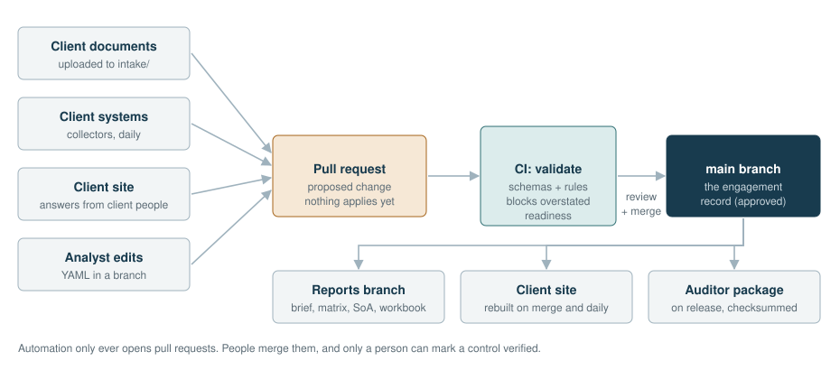

**Everything goes through a pull request.** Client documents, collected evidence, client answers and analyst edits all arrive the same way: as a proposed change that a person reviews and merges. Nothing automated can mark a control *verified*.

## 2. The engagement record

> **In plain terms:** Everything about one client's engagement lives in one folder, `engagement/`, as plain text files. Reports, the Word brief, the Excel workbook and the client site are all generated from that folder. You never edit a report; you change the record and the reports follow.

> **For GRC practitioners:** The record holds, per requirement, the owner and the four-part evidence test. It also holds the scope and context, the gap register, the evidence index (pointers to where artifacts are held), the AI system inventory, the internal audit programme and workpapers, the nonconformity register, management reviews and the documented information. Applicability decisions for Annex A controls, with justifications, make up the Statement of Applicability.

> **Under the hood:** the main files are:

| Path | Holds |
|---|---|
| `engagement/engagement.yaml` | Client profile, scope, what's already in place, dates, phases, budget, settings (sandbox, ingest, client view, client site) |
| `engagement/controls/<ID>.yaml` | One file per requirement (65 for ISO 42001): owner, applicability, the four legs and the evidence each cites |
| `engagement/gaps.yaml` | Gap register: finding, requirements, owner, due date, phase, severity, status, closure evidence |
| `engagement/evidence/index.yaml` | Evidence entered by people: location, collected date, approver, validity |
| `engagement/evidence/collected.yaml` + `collected/*.json` | Evidence written by collectors (machine-owned) and its snapshots |
| `engagement/inventory.yaml` | AI systems, models, datasets, tools, suppliers |
| `engagement/owners.yaml` | Owner roles mapped to GitHub users |
| `engagement/collectors.yaml` | Which automated checks run, and which control legs they support |
| `engagement/documents/DOC-*.md` | Policies and procedures |
| `engagement/impact/IA-*.yaml` | AI system impact assessments |
| `engagement/audit/…`, `engagement/findings.yaml` | Internal audit programme, workpapers, findings and corrective actions |
| `engagement/reviews/MR-*.yaml` | Management reviews and their input packs |
| `engagement/hours.yaml` | Timesheet |
| `engagement/submissions/SUB-*.yaml` | Answers sent from the client site |

## 3. The four-part evidence test

> **In plain terms:** For each requirement we ask four questions. Is it written down? Is it actually done? Are there records? Has someone checked that it works? A requirement only counts as ready when the answer to all four is yes, and the evidence behind each answer is current.

> **For GRC practitioners:** Each requirement is assessed on four legs: **Documented** (approved documented information), **Implemented** (the process operates), **Evidenced** (records of operation exist) and **Tested** (sampling, inspection or interview supports consistent operation). This mirrors what a certification auditor looks for. A client's assertion is recorded as *claimed* and treated as a hypothesis to test, never as evidence.

> **Under the hood:** each leg has `status` (`not_started`, `claimed`, `partial`, `verified`) and `evidence` (a list of ids). The rules check:
> - the type of evidence fits the leg (E012)
> - the evidence exists (E006) and is current (E007)
> - the legs are in order (E008)
> - the requirement has an owner (E009)
>
> Evidence ids can be `EV-…` (index or collector), `DOC-…` (an approved document), `IA-…` (an approved impact assessment), `MR-…` (a held management review) or `AUD-…/WP-…` (a reviewed internal audit workpaper).

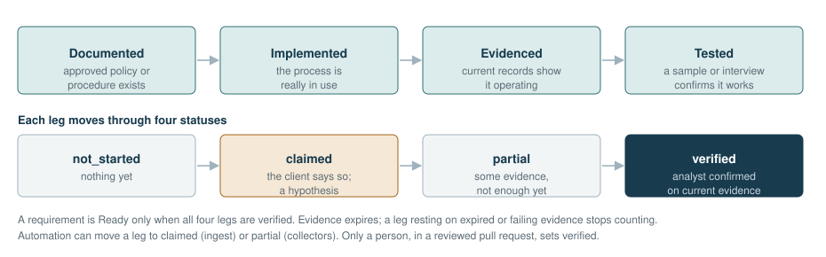

**Readiness states** shown in reports:

| State | Meaning |
|---|---|
| Ready | All four legs verified on current evidence |
| In progress | At least one leg partial or verified |
| Unverified claim | Only client claims so far |
| Not started | Nothing yet |
| Excluded | Annex A control not applicable (with justification) |
| Missing | No assessment file for the requirement yet (E002) |

## 4. Validation: the gate on every change

> **In plain terms:** Every proposed change is checked automatically before it can be merged. If a change would overstate readiness, the check fails and says why in plain words. Warnings point at things that need attention soon, such as evidence about to expire or a gap past its due date.

> **For GRC practitioners:** Validation enforces traceability (requirement → owner → current artifact → operating evidence), evidence freshness and type, leg ordering, auditor and approver independence, completeness of impact assessments, documents and management reviews, and the corrective-action lifecycle. It doesn't judge whether evidence is *sufficient*; that remains the analyst's and the auditor's judgment.

> **Under the hood:** `python -m grc validate` runs JSON Schema checks on every file, then the rule set (`grc/rules.py`). Errors (`E…`) fail the build. Warnings (`W…`) and information (`I…`) appear in the summary on the pull request. The full list is in [Appendix C](#appendix-c-validation-codes). To evaluate as of another date, put `--today` before the command, for example `python -m grc --today 2027-03-08 validate` to see what will have expired by Stage 1.

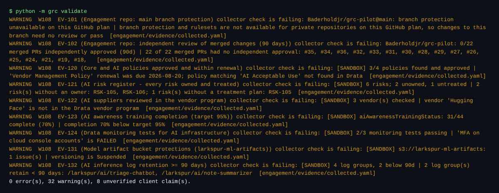

> **Screenshot to add:** a pull request's **Checks** tab showing *validate / validate* with the readiness summary.

## 5. Reports

> **In plain terms:** After every merged change, and once a day, the tool rebuilds a set of reports: a project brief in Word, tables of every requirement, the gap list, the evidence list, an Excel workbook and more. They live on a separate branch called `reports`, so there's always an up-to-date version, and the history shows how readiness changed day by day.

> **For GRC practitioners:** The outputs include:
> - the analyst brief (orientation document)
> - the control matrix
> - the Statement of Applicability
> - the gap register
> - the evidence index (requirement → evidence traceability)
> - registers for documented information, impact assessments, the internal audit, corrective actions and management reviews
> - the hours report
> - the client view
> - an Excel workbook of the whole record

> **Under the hood:** `python -m grc build --out out` writes Markdown, CSV, Word (`python-docx`, using the house-style template `templates/brief-template.docx`) and Excel (`openpyxl`). *Publish reports* (`publish-reports.yml`) commits the output to the `reports` branch after every push to `main` and daily. Word and Excel output is reproducible: the same record produces byte-identical files.

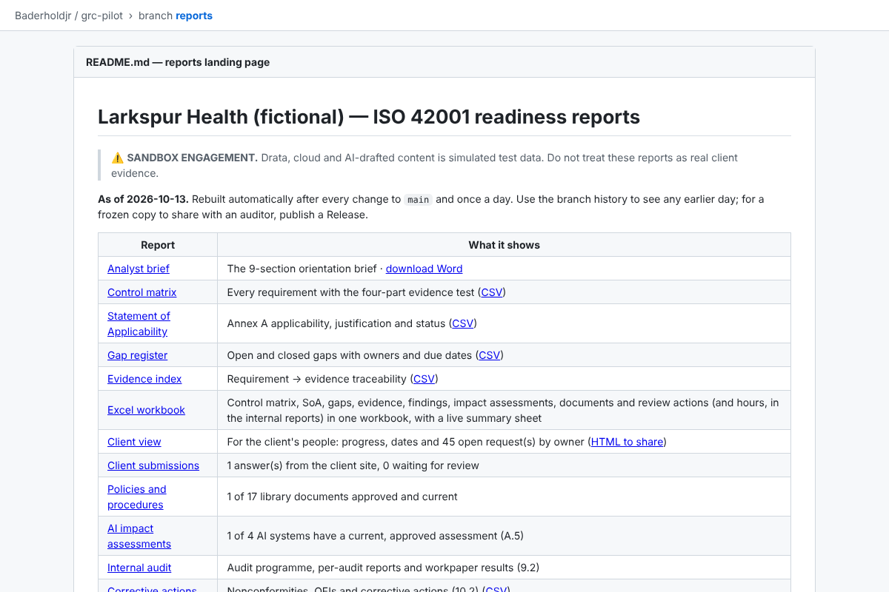

| Report | File | What it shows |
|---|---|---|
| Analyst brief | `brief.md`, `<client>-iso42001-brief.docx` | Client overview, AI usage, what's in place, scope, gaps, plan, risks |
| Control matrix | `control-matrix.md/.csv` | Every requirement with owner, state and the four legs |
| Statement of Applicability | `soa.md/.csv` | Annex A applicability, justification and status |
| Gap register | `gap-register.md/.csv` | Open and closed gaps with owner and due date |
| Evidence index | `evidence-index.md/.csv` | Each piece of evidence, where it is, its expiry and what cites it |
| Workbook | `<client>-iso42001-workbook.xlsx` | All of the above in sheets, with a live Summary |
| Status | `status.json` | Machine-readable readiness figures |

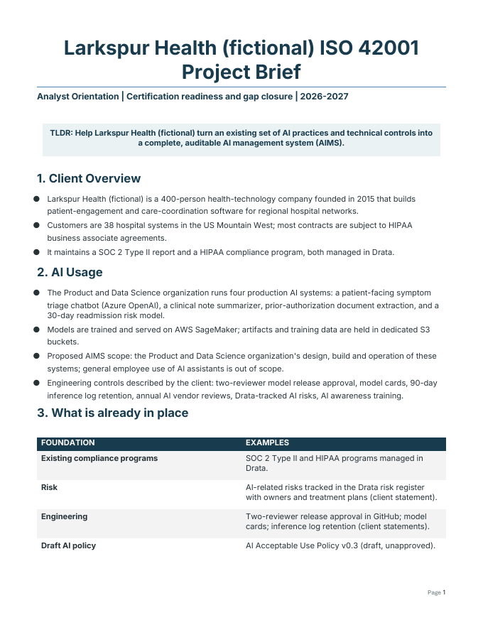

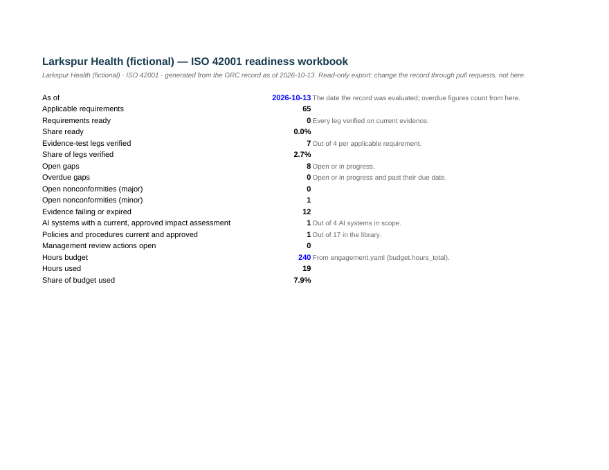

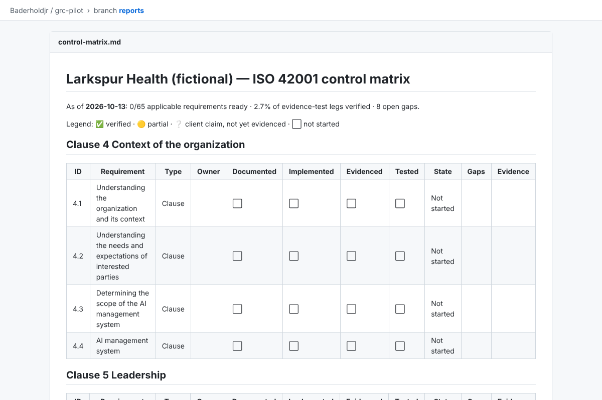

## 6. Reading client documents (ingest)

> **In plain terms:** Upload the client's documents (policies, spreadsheets, questionnaires) and the tool drafts the engagement record from them: gaps, evidence locations, AI systems and the client's statements about what they already do. The draft arrives as a pull request with a list of open questions for the analyst. Nothing is accepted until you merge it.

> **For GRC practitioners:** Ingestion turns client self-assessments into a first-pass gap analysis. Client statements become *claims* on the relevant requirement (a hypothesis), never evidence. Every drafted item cites its source document and passage. Items without a source are dropped. A claim naming a requirement that isn't in the catalog is dropped; a gap keeps only its valid requirement ids, and is dropped if none are valid.

> **Under the hood:** Ingestion runs from `ingest.yml` on any pull request that adds files to `intake/`. It works in two ways:
> - **Spreadsheet templates** (`templates/intake/*.csv`) are imported as written.
> - **Other documents** (Word, PDF, Excel, Markdown, text) are drafted by Claude when `ingest.ai_drafting: true` is set and the `ANTHROPIC_API_KEY` secret is present.
>
> In both cases:
> - Narrative fields are only filled when they're empty.
> - A leg moves `not_started` → `claimed` and never further.
> - Processed files and their hashes are recorded in `intake/.processed.yaml`.
>
> Timesheets under `intake/timesheets/` are never sent to AI drafting.

## 7. Collecting evidence automatically

> **In plain terms:** Instead of asking the client for screenshots every month, the tool checks their systems directly every day, read-only. For example, it checks that code changes are reviewed, cloud logs are kept, policies are approved, and AI incidents are handled on time. When a check fails, everyone sees it straight away.

> **For GRC practitioners:** Collectors provide continuous, objective operating evidence, mainly for the *Implemented* and *Evidenced* legs. Each run stores a metadata snapshot with a SHA-256 hash, and collected evidence expires (30 days by default), so it must keep passing. A failing check stops the evidence counting immediately. Collector populations, such as merged PRs or Jira tickets, become the sampling populations for the internal audit.

> **Under the hood:** `collect.yml` runs daily and opens a rolling *Evidence refresh* pull request. Checks are configured in `engagement/collectors.yaml`, each with an id, params and `supports:` (the control legs it backs). The available collectors are:
> - **GitHub:** branch protection, PR reviews, workflow runs, file present
> - **Drata:** policies, risks, vendors, training, monitoring tests
> - **AWS:** CloudTrail, S3, log retention, SageMaker model registry
> - **Azure and Google Cloud**
> - **Jira:** JQL with SLA checks
> - **SharePoint** (Microsoft Graph) and **Google Drive:** documents published and current
> - **MLflow:** model metadata and approvals
>
> Credentials are read-only and stored as repository secrets or variables (`docs/AUTOMATION.md`).
>
> **Sandbox mode** (`sandbox.enabled: true`) answers every service except GitHub from canned files in `sandbox/`, and labels everything `[SANDBOX]`.

| Effect | Rule |
|---|---|
| A leg verified only on evidence whose check is failing | E015 (error) |
| A check failing or unable to run | W108 / W109 (warning) |
| A passing check with `supports:` | Cited automatically on those legs, which move to *partial* if the control has an owner |
| A passing check without `supports:` | Listed in the refresh PR as not yet cited |

## 8. Gaps, owners and reminders

> **In plain terms:** Every gap has an owner and a due date. The tool turns each gap into a GitHub issue assigned to its owner, groups issues by project phase, and reminds owners when something is overdue. Owners also become required reviewers for changes to their own controls.

> **For GRC practitioners:** The gap register is the remediation plan. Closing a gap requires closure evidence (E013). Each requirement needs an accountable owner before any progress counts (E009). Owner roles map to people, which also feeds the independence checks for auditors, assessors and approvers.

> **Under the hood:**
> - `sync-issues.yml` mirrors `gaps.yaml` to Issues and phase milestones. Re-running updates the existing issues; a closed gap closes its issue. Reminders are posted once per due date.
> - `owners.yaml` maps role names to GitHub users or teams.
> - `python -m grc codeowners` writes a managed block in `.github/CODEOWNERS`.
> - `freshness.yml` runs weekly and maintains one `grc-drift` issue listing expired evidence and overdue gaps.

## 9. Policies and procedures

> **In plain terms:** ISO 42001 expects a set of approved policies and procedures. The tool includes a library of 17 templates covering every requirement. It drafts them for the client using what's already in the record, can ask AI to fill the gaps (with sources), and records exactly what text was approved, so nobody can change it quietly afterwards.

> **For GRC practitioners:** This covers documented information (7.5) and the *Documented* leg of every requirement:
> - **The library:** scope and context, AI policy, roles, risk, impact assessment, objectives and changes, people, documented information, resources, lifecycle, data, information for users, responsible use, third parties, monitoring and internal audit, management review, and improvement.
> - **Approval** requires completeness and an approver independent of the author.
> - **The approval fingerprint** (SHA-256 of the text and approval details) gives document-control integrity.
> - **Reviews** are due every 365 days.

> **Under the hood:** *Policies and procedures* (`docs.yml`) or `python -m grc docs`:
> - **`new all`** drafts the documents from the templates in `frameworks/iso42001/documents/`, leaving `[[TODO: …]]` markers.
> - **`fill`** has AI replace only the markers, each fill citing its source.
> - **`approve DOC-… --approver "…"`** refuses an incomplete or self-approved document, then records the approver, the date and the fingerprint.
>
> An approved document is cited as `DOC-…` evidence. Rules: E040–E042, W140–W143.

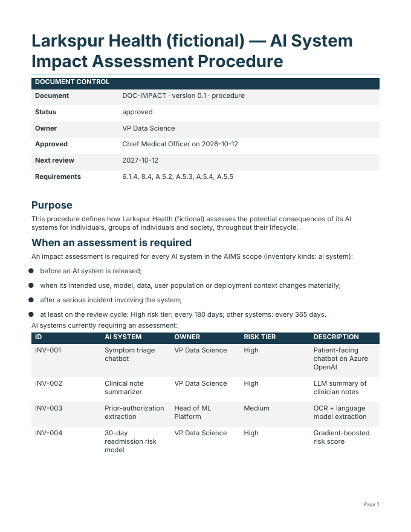

## 10. AI system impact assessments

> **In plain terms:** For each AI system, the client must think through how it could affect people (safety, privacy, fairness and more), what they do to reduce that, and who accepted the remaining risk. The tool starts one assessment per AI system, checks it's complete before anyone can approve it, and reminds you when it's due for review.

> **For GRC practitioners:** This covers clause 6.1.4, clause 8.4 and Annex A.5.2–A.5.5:
> - **Screening:** 11 impact categories, across individuals, groups and society.
> - **Scoring:** likelihood × severity on 1–5 scales, with bands Low, Medium, High and Critical.
> - **Residual risk:** scored after mitigation. High residual needs independent acceptance; Critical can't be approved.
> - **Review cycle:** 180 days for high-risk systems, 365 for others.

> **Under the hood:**
> - *AI impact assessment* (`impact.yml`) or `python -m grc impact new all` creates `engagement/impact/IA-NNN.yaml` for each in-scope `ai_system` in `inventory.yaml`, with context prefilled.
> - An approved assessment is cited as `IA-…` evidence.
> - Rules: E030–E032, W130–W133.

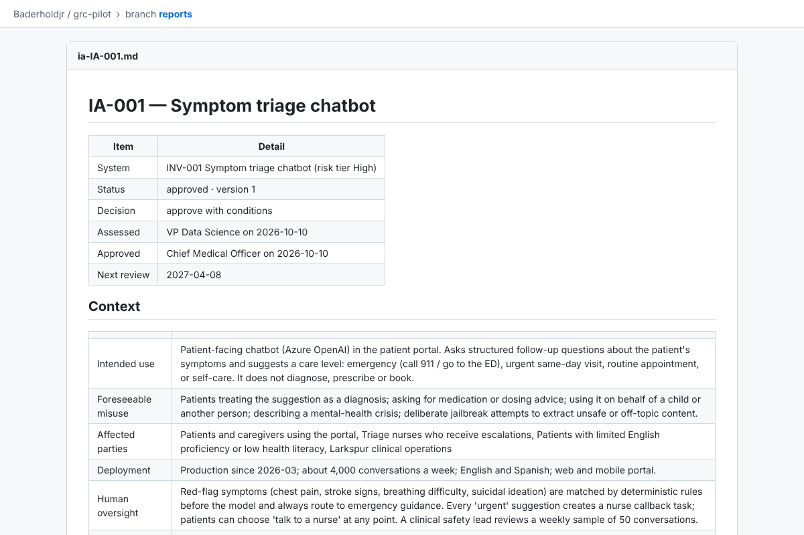

## 11. Internal audit and corrective actions

> **In plain terms:** Before the certification audit, the client must audit itself. The tool writes the audit worksheets, picks samples fairly and repeatably, makes sure auditors don't audit their own work, and tracks every finding until it's fixed and the fix is shown to work.

> **For GRC practitioners:** This covers the internal audit programme (9.2) and nonconformity and corrective action (10.2):
> - **Workpapers:** one per in-scope requirement, with test steps built from intent, expected evidence, owner, claims and gaps.
> - **Sampling:** attribute sampling with a fixed size table and a reproducible seeded selection. The population size, hash and seed are recorded.
> - **Independence:** auditors may not own controls in scope (E020).
> - **Finding lifecycle:** open → action planned → implemented → closed, with independent effectiveness review. Major nonconformities can't be risk-accepted. A *Tested* leg can't be verified while a major NC is open (E026).

> **Under the hood:**
> - *Internal audit* (`audit.yml`) or `python -m grc audit plan|sample AUD-YYYY-NN` works from `engagement/audit/program.yaml`.
> - Workpapers live in `engagement/audit/<AUD>/workpapers/WP-NN.yaml`; findings in `engagement/findings.yaml`, which become Issues labelled `grc-finding`.
> - A reviewed *effective* workpaper is cited as `AUD-…/WP-…` test evidence.
> - Rules: E020–E022, E024–E026, W120–W125.

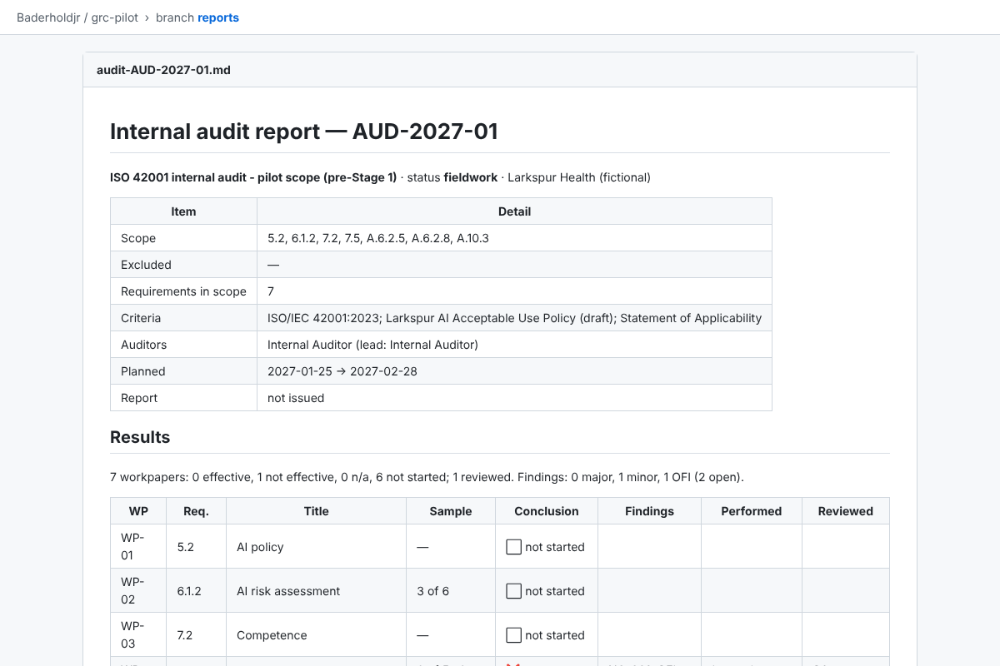

## 12. Management review

> **In plain terms:** Leadership must meet regularly to look at how the AI program is going and decide what to do. The tool builds the pack they review from the record, freezes it so it can't be changed afterwards, checks the minutes cover everything, and chases the actions.

> **For GRC practitioners:** This covers management review (9.3). The pack covers every required input:
> - previous actions
> - context changes
> - interested parties
> - performance: nonconformities, monitoring results and audit results
> - risks and impacts
> - opportunities for improvement
> - resources
>
> The minutes must record notes against each input, plus decisions and actions with owners and due dates. A held review with approved minutes is evidence for 9.3.

> **Under the hood:**
> - *Management review* (`review.yml`) or `python -m grc review new YYYY-MM-DD` / `review pack MR-YYYY-NN`.
> - The pack's date and SHA-256 are stored.
> - Actions become Issues labelled `grc-review-action`.
> - Rules: E050–E052, W150–W153.

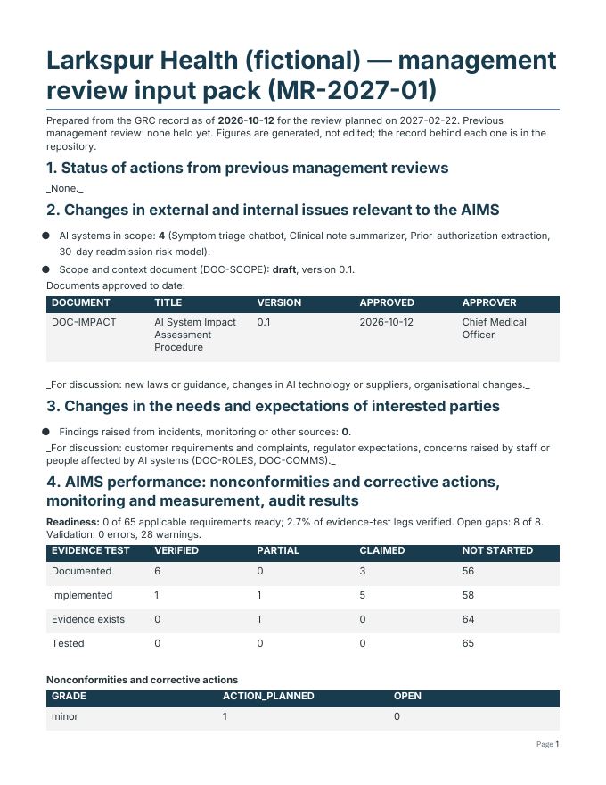

## 13. Hours and budget

> **In plain terms:** Drop in exports from your time tracker and the tool shows hours used, where they went and whether you'll finish within budget. It's for the engagement team only; clients and auditors never see it.

> **For GRC practitioners:** This is engagement economics, not audit evidence. It is excluded from the client view, the client site and everything auditors receive. The auditor package leaves out the timesheet and the workbook's Hours sheet, its brief and status summary omit hours and budget, and budget warnings are left out of its known issues.

> **Under the hood:**
> - **Importing:** CSV exports (Toggl, Harvest, Clockify, generic) go in `intake/timesheets/`, and *Hours* (`hours.yml`) opens a *Timesheet update* PR.
> - **Filtering:** the `HOURS_MATCH` repository variable keeps only one client's rows.
> - **Logging by hand:** `python -m grc hours log …` adds a single entry.
> - **Forecast:** based on the last four weeks.
> - Rules: E060, W106, W160, W161, W163.

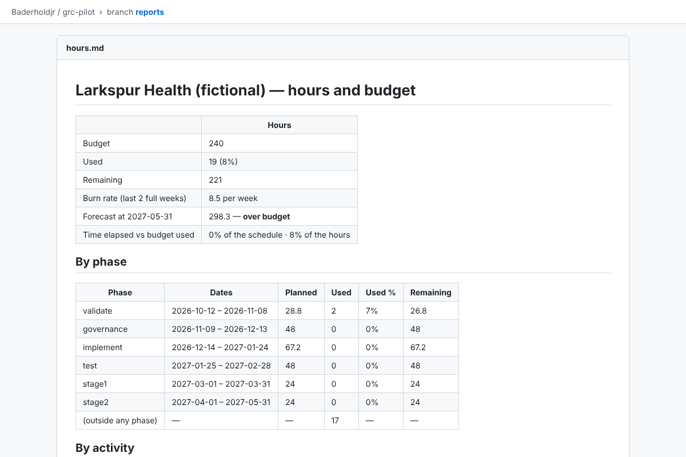

## 14. Client view

> **In plain terms:** A single page for the client's people that says where things stand, what's coming up and what each person needs to do, overdue items first. It's safe to email: no budget, hours or internal notes.

> **For GRC practitioners:** Requests are generated from:
> - open evidence-test legs (written as plain asks)
> - gaps and findings
> - draft documents and impact assessments
> - management review actions
>
> Requirements without an owner are collapsed into one "needs an owner" item.

> **Under the hood:** every build writes `client-view.html` (self-contained, no external resources, strict content-security policy) and `client-view.md`. Optional settings go under `client_view: {intro, contact}` in `engagement.yaml`.

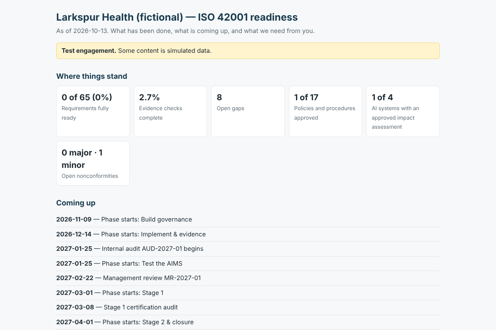

## 15. Client site

> **In plain terms:** A small private website where the client's people sign in with their email, see their readiness at a glance, and answer what's needed from them, one request at a time. Their answer comes to you for review. You reply by accepting it or asking for more, and they see your reply on the site.

> **For GRC practitioners:** The client site gives a controlled channel for client input. It has these properties:
> - Every answer is attributable to a verified identity and arrives as a reviewable change.
> - Answers never alter assessment status; the analyst files evidence after review.
> - The site carries no patient or personal data: clients share links to their own systems and must confirm the answer contains none.
> - Each request is layered: what we need, why it matters, and what good evidence looks like.

> **Under the hood:**
> - `python -m grc portal` builds a static site plus a Cloudflare Worker. *Client site* (`portal.yml`) deploys it after every merge and daily.
> - Cloudflare Access (one-time PIN) controls who can sign in, and the Worker verifies the Access token itself. If the Access settings are missing, it refuses everyone.
> - Answers become `engagement/submissions/SUB-YYYYMMDD-xxxxxx.yaml` in a pull request labelled `client-submission`, written with a fine-grained GitHub token scoped to the client repository.
> - Rules: E070, W170–W172. `submissions.md` is the analyst's queue.
> - Setup: `docs/CLIENT-SITE.md`.

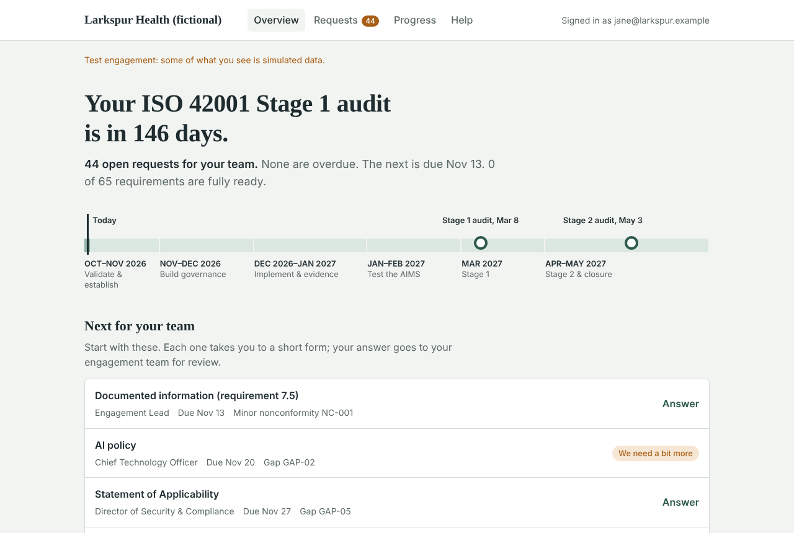

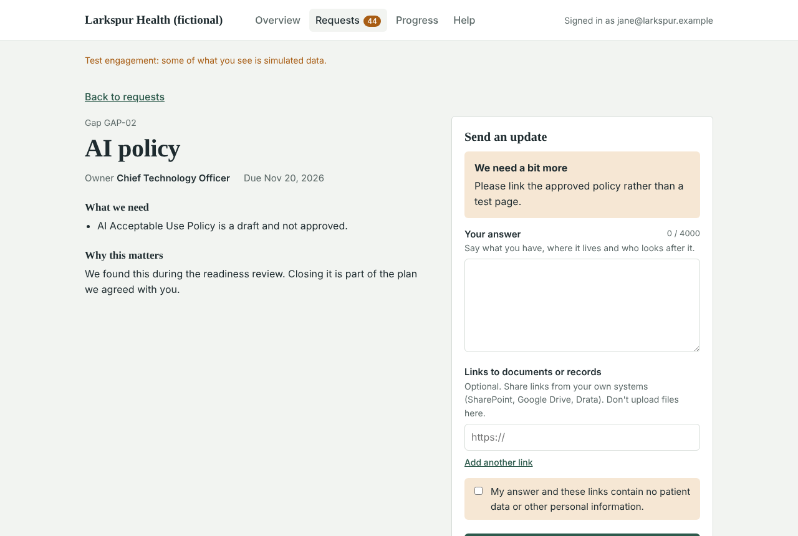

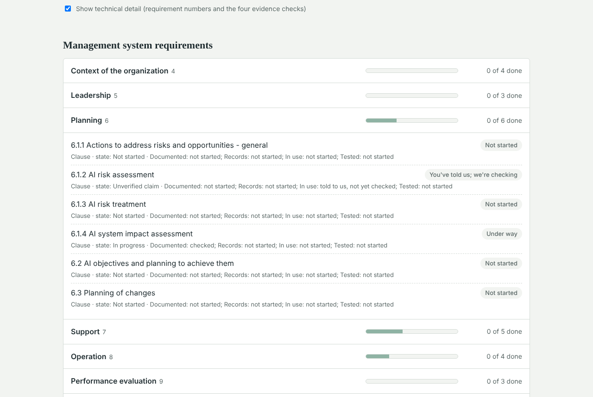

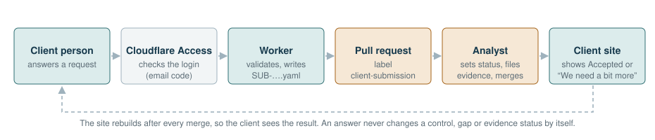

| Site page | What it shows |
|---|---|
| Overview | Days to Stage 1, open requests, the path to certification, the next four requests, key figures |
| Requests | Grouped by due date, filterable by person; *Needs action*, *Sent* and *All* views |
| One request | What we need, why it matters, what good evidence looks like, the answer form, the analyst's reply |
| Progress | Each area with done / under way / not started; optional requirement numbers and evidence checks |
| Help | Each term in plain language, with the technical term underneath |

## 16. Auditor package

> **In plain terms:** When the certification auditor arrives, give them one checksummed bundle: every report as a PDF, an index that traces each requirement to its evidence, and the source record. Anyone can rebuild it from the same version and get exactly the same files, which proves nothing was altered.

> **For GRC practitioners:** This is the Stage 1, Stage 2 or surveillance submission set. The auditor index gives requirement → leg → evidence traceability, says where each item is held, and lists known issues at packaging. Validation errors block a release package; warnings are disclosed.

> **Under the hood:**
> - **Releasing:** publishing a GitHub Release runs `release.yml`, which attaches the package zip and the auditor index PDF, and nothing else. Locally, run `python -m grc package --out dist --label stage1`.
> - **Sharing:** give the auditor the zip (or the index PDF), not access to the Release page. The release notes carry the full validation summary, including budget warnings.
> - **Contents:** PDFs (ReportLab), `manifest.json`, `SHA256SUMS` and a deterministic zip.
> - **Excluded:** the timesheet, hours and budget figures, the client view and `submissions.md`.

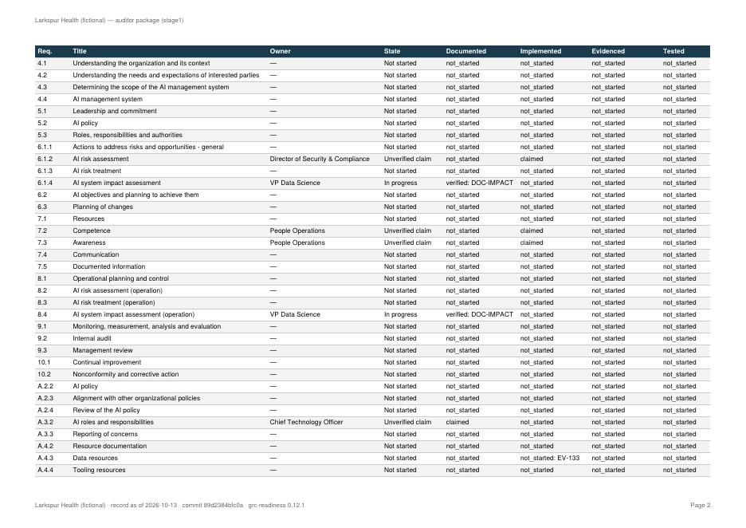

## 17. Engine, client repositories and upgrades

> **In plain terms:** The tool itself lives in one place, and each client gets their own private copy of the record. When the tool improves, each client receives an "upgrade" change to review and accept, so nothing changes under a client's feet.

> **For GRC practitioners:** Each client's record is isolated in its own private repository, with its own access control. Engine changes are versioned and adopted per client through a reviewed change, with validation run against the new version first.

> **Under the hood:**
> - **Pinning:** client `requirements.txt` pins `engine-vX.Y.Z`, and the workflow wrappers call `@engine-v0`.
> - **Releasing:** *Release GRC engine* (`engine-release.yml`) tests, tags and moves `engine-v0`. Each client's weekly *Upgrade GRC engine* opens the bump PR.
> - **New clients:** `python -m grc bootstrap` writes a new client repository, and *New engagement* resets the record with phases computed from your dates.
> - **Engine access:** client repos read the private engine with the `GRC_ENGINE_TOKEN` secret.
> - **New workflow files** in a client repo are added by a person; GitHub's built-in token can't add them.

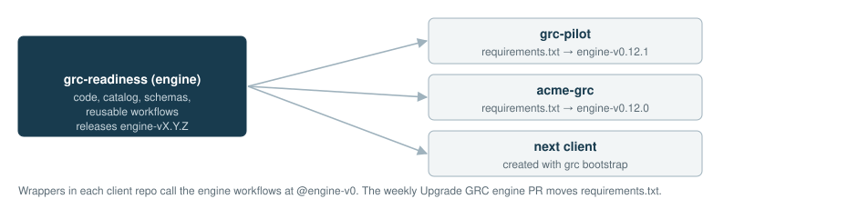

## 18. Frameworks

> **In plain terms:** ISO 42001 (AI), ISO 27001 (information security) and SOC 2 are built in. A client working towards more than one gets one workspace with a record per framework, and sees each on the client site as its own tab. Where one process serves both standards (for example document control), the evidence is collected once and counts for both, but only after a person has signed off that the two requirements really match.

> **For GRC practitioners:** Each standard keeps its own record:
> - its own Statement of Applicability, gaps and policies
> - its own internal audit, management review and auditor package
>
> **Mappings:** proposed mappings link the two standards' requirements as *equivalent*, *related*, *subset* or *superset*. Only a reviewed *equivalent* mapping lets evidence from one record be cited in the other; the others are pointers for the analyst.
>
> **Borrowed evidence:** it keeps its own freshness and approval rules.
>
> **Shipped for ISO 27001:**
> - the catalog: 25 clauses and 93 Annex A controls, our own paraphrase
> - a 20-document ISMS library covering every requirement once
> - no impact assessments
>
> **Shipped for SOC 2:**
> - the AICPA Trust Services Criteria: 33 common criteria (Security) plus 28 in the optional Availability, Confidentiality, Processing Integrity and Privacy categories, in our own words
> - an 18-document library covering every criterion once; documents for categories the client didn't choose are left out
> - a proposed mapping to ISO 27001 (4 equivalent, 2 subset, 1 superset, 42 related)

> **Under the hood:**
> - **Where each framework lives:** `frameworks/<id>/catalog.yaml`, `playbook.yaml` and `documents/`.
> - **Second record:** a second framework's record lives in `engagement-<name>/`. `python -m grc engagements` lists the records.
> - **Workflows:** the record-wide workflows loop over every record. The ones you run by hand take an **engagement** input.
> - **Mappings:** in `mappings/<a>__<b>.yaml`. The engine's are proposals; copy one to the repository root and fill `reviewed_by` and `reviewed_on`.
> - **Citing across records:** cite as `<framework>:<id>`, for example `iso42001:DOC-DOCINFO`.
> - **Rules:** E080, E081, I180.
> - **Report:** `cross-framework.md` in each record's reports.
> - **Framework wording:** a catalog can declare its own requirement `kinds:` and optional `categories:`; a playbook its `terms:` (milestone names, applicability report title) and Help-page `glossary:`. ISO wording is the default.
> - Details: `docs/FRAMEWORKS.md`.

### SOC 2

> **In plain terms:** A SOC 2 report is what many customers ask for before they trust a company with their data. An independent CPA firm checks the controls and writes the report; we get the client ready for that. Security is always included; the client chooses whether to add Availability, Confidentiality, Processing Integrity or Privacy. Instead of two audit visits, SOC 2 has an *observation period*: months in which every control has to run, and leave records, each time it should.

> **For GRC practitioners:**
> - **Categories** are chosen per record (`scope.categories`). Criteria outside them disappear from requests, reports and the document library.
> - **Applicability:** every criterion in a chosen category applies; one marked not applicable needs a justification for the system description (E004). The *Criteria Applicability* report replaces the Statement of Applicability.
> - **Dates:** `stage1` is the observation period start (and Type 1 as-of date, if any); `stage2` is the observation period end. The phases run from scoping through a readiness assessment to the observation period.
> - **References:** internal audit → CC4.1, corrective actions → CC4.2, management and board review → CC1.2.
> - **Independence:** we prepare the client; the examination is done by a CPA firm independent of the client, which must not have taken on management responsibilities for it.

> **Under the hood:**
> - Start a record with `new-engagement --framework soc2 --categories availability,confidentiality` (or the *categories* input of the New engagement workflow).
> - Adding a category later: set `scope.categories`, then `python -m grc init` creates the new assessment files (E002 until then). An unknown category is E016.
> - Catalog and playbook: `frameworks/soc2/`. Mapping: `mappings/iso27001__soc2.yaml`.

| | ISO 42001 | ISO 27001 | SOC 2 |
|---|---|---|---|
| Requirements | 27 clauses + 38 Annex A controls | 25 clauses + 93 Annex A controls | 33 common criteria + up to 28 optional |
| Policy and procedure library | 17 documents | 20 documents | 18 documents (fewer without optional categories) |
| Impact assessments | Yes (AI systems) | No | No |
| Outcome | Certificate | Certificate | Attestation report (Type 1 or Type 2) |
| Audit milestones | Stage 1, Stage 2 | Stage 1, Stage 2 | Observation period start, end |
| Proposed mappings | to ISO 27001: 4 equivalent, 35 related | to 42001 (left); to SOC 2: 4 equivalent, 2 subset, 1 superset, 42 related | to ISO 27001 (left) |

## 19. Boundaries: what the tool will and won't do

> **In plain terms:** The tool keeps the books straight. It doesn't decide whether the client is compliant; people do that.

- **It never marks a control verified by itself.** Automation proposes; people decide in a reviewed pull request.
- **It doesn't judge sufficiency.** It checks that evidence exists, is current, is the right type and is traceable. Whether it is *enough* is the analyst's and auditor's call.
- **It doesn't hold confidential artifacts.** The evidence index stores pointers, dates and approvers. Artifacts stay in the client's systems, and every client repository stays private.
- **It doesn't reproduce ISO text or the AICPA criteria.** The catalogs paraphrase them. Work from a licensed copy of the standard and the AICPA's published criteria.
- **It doesn't perform the SOC 2 examination.** Only a CPA firm independent of the client can. A firm that both advises and examines a client must not take on management responsibilities, or its independence is impaired.
- **GitHub plan limits.** On GitHub Free, private repositories can't use branch protection or rulesets. That means the requirement that `validate` passes and that CODEOWNERS approve is **not enforced** by GitHub, only by your own practice. (The pilot's own check, EV-101, reports exactly this.) For real client engagements, use a plan that supports protected branches on private repositories (GitHub Team or Pro).
- **Client site in proof-of-concept mode.** The free Cloudflare setup is for test data. Before real client data goes through it, move to single sign-on, a custom domain, a GitHub App and rate limiting (`docs/CLIENT-SITE.md`).

---

## Appendix A: Commands

Run from a client repository (or the engine repo) with the engine installed. Two options go **before** the command and work with all of them: `--engagement DIR` (default `engagement`) and `--today YYYY-MM-DD`, for example `python -m grc --today 2027-03-08 validate`.

| Command | What it does |
|---|---|
| `python -m grc validate [--strict] [--format text\|github\|json]` | Schemas and readiness rules (the CI gate) |
| `python -m grc build --out out [--no-docx] [--force]` | All reports, Word and Excel |
| `python -m grc init` | Create a control file for any catalog requirement without one |
| `python -m grc sync-issues [--apply]` | Mirror gaps to Issues and milestones (dry run by default) |
| `python -m grc collect [--only EV-…] [--dry-run]` | Run evidence collectors |
| `python -m grc ingest` | Draft the record from new files in `intake/` |
| `python -m grc new-engagement --client … --start … --stage1 … --stage2 … --confirm-reset` | Reset the record for a new client |
| `python -m grc codeowners` | Write control owners into CODEOWNERS |
| `python -m grc bootstrap --dir DIR --engine-repo OWNER/REPO` | Write a new thin client repository |
| `python -m grc audit plan\|sample AUD-YYYY-NN` | Internal audit workpapers and samples |
| `python -m grc impact new INV-…\|all` | Start impact assessments |
| `python -m grc docs new\|fill\|approve …` | Policies and procedures |
| `python -m grc review new DATE` / `review pack MR-…` | Management review |
| `python -m grc package --out dist --label stage1` | Auditor package |
| `python -m grc hours import FILES… [--match …]` / `hours log …` | Timesheet |
| `python -m grc portal --out _portal [--repo OWNER/REPO] [--also DIR]` | Client site bundle (other records become tabs automatically) |
| `python -m grc engagements` | List the records in this repository (`engagement/`, `engagement-*/`) |

## Appendix B: Workflows

In each client repository, under **Actions**:

| Workflow | Runs | What it does |
|---|---|---|
| Validate & build readiness reports | Every PR, and pushes to main | The gate; posts the readiness summary and uploads the reports |
| Publish reports | After merge to main; daily | Rebuilds the `reports` branch |
| Client site | After merge to main; daily | Builds the client site and deploys it to Cloudflare when configured |
| Collect evidence | Daily, or Run workflow | Runs collectors; opens the *Evidence refresh* PR |
| Ingest client documents | PRs that add files to `intake/` | Drafts the record from documents |
| Sync gap register to GitHub Issues | Merges that change gaps, findings, owners, reviews or `engagement.yaml`; daily | Issues, milestones, reminders |
| Weekly evidence freshness check | Mondays | Maintains the `grc-drift` issue |
| Policies and procedures | Run workflow | `new`, `fill` or `approve` documents |
| AI impact assessment | Run workflow | Start assessments |
| Internal audit | Run workflow | `plan` or `sample` |
| Management review | Run workflow | `new` or `pack` |
| Hours | Merges that change `intake/timesheets/`, or Run workflow (`import` or `log`) | Import or log hours |
| New engagement | Run workflow | Reset the record for a new client |
| Upgrade GRC engine | Tuesdays, or Run workflow | Opens the engine upgrade PR |
| Publish evidence package | When you publish a Release | Attaches the auditor package zip and index PDF |

In the engine repository, **Release GRC engine** publishes a new engine version.

## Appendix C: Validation codes

| Code | Severity | Rule |
|---|---|---|
| E000 | error | A rule couldn't be evaluated on a record (usually malformed data also reported elsewhere) |
| E001 | error | A file doesn't match its schema; or a submission, review or document header isn't valid YAML (other files stop validation with a "not valid YAML at line N" message) |
| E002 / E003 | error | A requirement has no assessment file / a file isn't in the catalog |
| E004 | error | Annex A control or SOC 2 criterion marked not applicable without a justification, or a mandatory clause excluded |
| E005 | error | Leg is verified but cites no evidence |
| E006 | error | Cites evidence that isn't in the index |
| E007 | error | Leg is verified but its evidence has expired (or the document, assessment or review is past review) |
| E008 | error | Legs out of order |
| E009 | error | Progress recorded with no accountable owner |
| E010 | error | Gap references an unknown requirement or phase |
| E011 | error | Duplicate evidence, gap, finding or audit id; or a collector check uses a human-owned evidence id |
| E012 | error | Evidence type doesn't fit the leg |
| E013 | error | Gap closed without valid closure evidence |
| E014 | error | Dates out of order: Stage 1 not before Stage 2 (SOC 2: observation start not before its end), a phase ending before it starts, an audit ending before it starts |
| E015 | error | Leg verified on evidence whose check is failing, or on an unsound document, assessment or review |
| E016 | error | `scope.categories` names a category the framework doesn't have (or the framework has no optional categories) |
| E020–E022, E024–E026 | error | Internal audit: independence, status ahead of work, incomplete workpapers, finding lifecycle, unknown references, Tested verified with an open major NC |
| E030–E032 | error | Impact assessment: unknown references, approved while incomplete or by its assessor, residual risk not acceptable or not accepted |
| E040–E042 | error | Documents: unknown requirement, approved while incomplete or self-approved, changed after approval |
| E050–E052 | error | Management review: unknown inputs, incomplete record, actions without owner, due date or evidence |
| E060 | error | Timesheet entry invalid |
| E070 | error | Client submission id doesn't match its file name |
| E080 | error | Evidence cited from another framework's record (`iso42001:EV-001`) with no such record, or no reviewed equivalent mapping for this requirement |
| E081 | error | Cross-framework mapping file invalid (schema, frameworks, unknown requirement ids) |
| W101 | warning | Evidence expiring soon |
| W102 | warning | Operates in practice but isn't in an approved document |
| W103 | warning | Open gap or finding with no owner |
| W104 / W105 | warning | Gap past due / due after its phase ends |
| W106 | warning | 80% of the hours budget used |
| W107 | warning | A phase overlaps the previous one |
| W108 / W109 | warning | A collector check is failing / ran but errored |
| W110 / W111 | warning | Client claim with no owner / owner not in owners.yaml |
| W112 | warning | SOC 2: an open gap whose requirements are all in categories taken out of scope; it is no longer chased (no request, issue closed) |
| W120–W123 | warning | Finding past due; 9.2 verified while no audit has reached reporting or closed; audit overrunning; in-scope requirement without a workpaper |
| W124 / W125 | warning | Audit scope or exclude entry matches no requirement / a workpaper cited on a different requirement from the one it tested |
| W130–W133 | warning | AI system without an assessment; not yet approved; past review; residual above inherent |
| W140–W143 | warning | Library documents not started; draft not approved; past review; approved but not cited |
| W150–W153 | warning | Planned review date passed without the review recorded as held; none held within the cycle or before Stage 1; action overdue; 9.3 verified without a held review |
| W160 / W161 / W163 | warning | Phase over its hours; forecast over budget; manual hours figure disagrees |
| W170 | info | Submission answers a request that is no longer open |
| W171 | warning | Client submission waiting for review longer than `triage_days` (default 5) |
| W172 | warning | Submission lists evidence that isn't in the index |
| I180 | info | Reuse opportunity: the other framework's record has verified a mapped leg; its evidence could be cited here |
| I201 | info | Client claim not yet backed by evidence (the follow-up list) |

## Appendix D: Glossary

| Term | Plain meaning | Technical meaning |
|---|---|---|
| AIMS | The company's system for managing its AI responsibly | AI management system, the subject of ISO/IEC 42001 |
| Annex A control | A specific good practice the standard lists | Reference control in ISO/IEC 42001 Annex A; applicability decided in the SoA |
| Claim | Something the client says they do, not yet checked | Leg status `claimed`; a hypothesis to test (I201) |
| Clause | A mandatory part of the standard | Clauses 4–10; can't be excluded |
| Collector | An automatic, read-only check of a client system | `grc/collectors/*`, configured in `collectors.yaml` |
| CODEOWNERS | Who must approve changes to which files | `.github/CODEOWNERS`, written by `grc codeowners` |
| Evidence | Proof that something is written down, happens or works | An entry in the evidence index, or a DOC/IA/MR/workpaper id |
| Gap | Something missing before the audit | An entry in `gaps.yaml` |
| Leg | One of the four questions asked of each requirement | Documented, Implemented, Evidenced, Tested |
| Nonconformity (NC) | A requirement not met | Major or minor finding in `findings.yaml` |
| OFI | A suggestion for improvement | Opportunity for improvement |
| Pull request (PR) | A proposed change, waiting for review | A GitHub pull request; merging is approval |
| Sandbox | Practice mode with fake data | `sandbox.enabled: true` |
| SoA | The list of which controls apply and why | Statement of Applicability |
| Stage 1 / Stage 2 | The two visits by the certification body | Readiness review / certification audit (ISO/IEC 17021-1) |
| Verified | Confirmed by the analyst on current evidence | Leg status `verified`; only set by a person |
