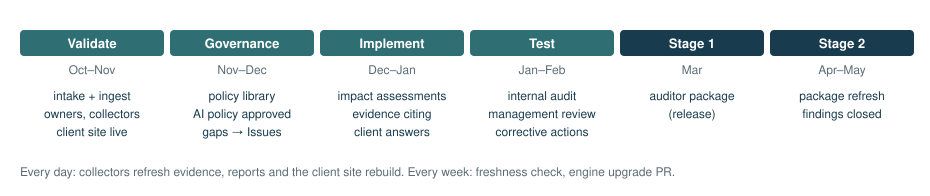
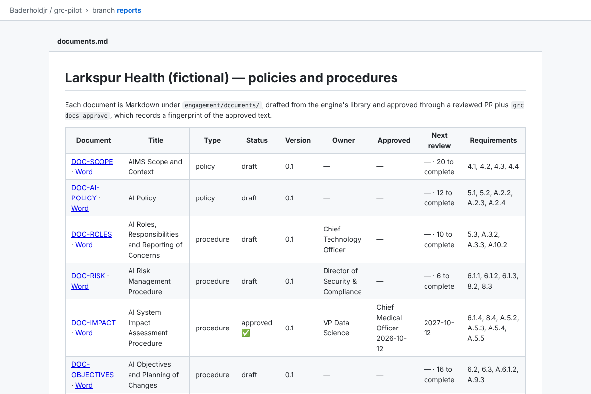
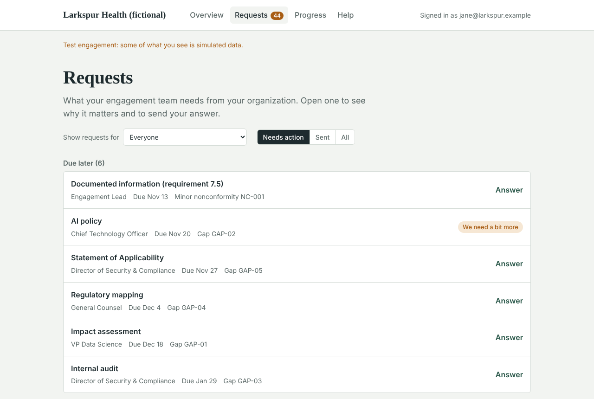
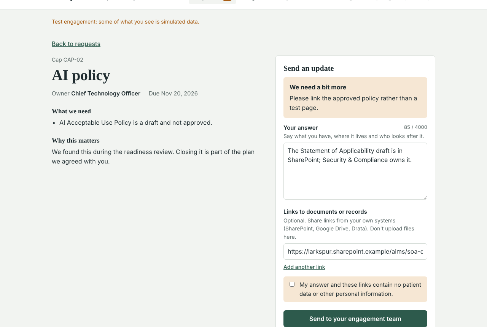
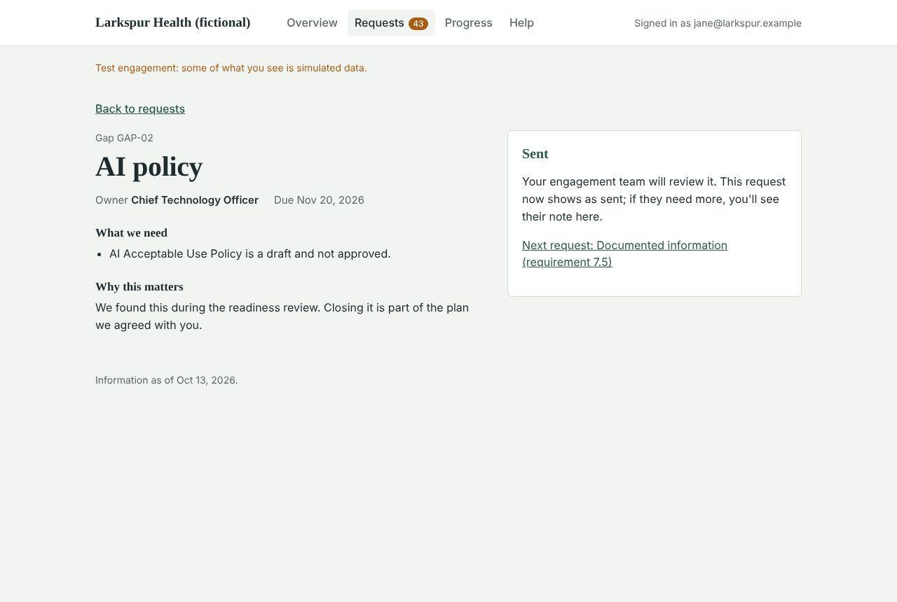
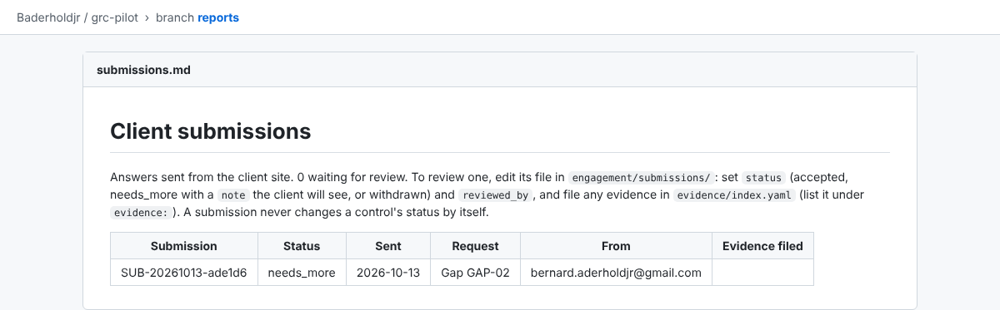

# Part 2: Training guide

A step-by-step walkthrough of a full engagement, using the pilot client **Larkspur Health (fictional)**. Work through it in order the first time. Each module says what you'll do, why it matters, how to do it, and how to check it worked.

You'll need:
- access to the client repository (for the pilot, `Baderholdjr/grc-pilot`)
- a GitHub account
- for module 9, a Cloudflare account

You don't need a terminal. Every step can be done from the GitHub website. Where a command-line equivalent exists, it's shown for analysts who prefer it.



## Modules

0. [The golden rules](#module-0-the-golden-rules)
1. [Set up the client repository](#module-1-set-up-the-client-repository)
2. [Read the record](#module-2-read-the-record)
3. [Bring in client documents](#module-3-bring-in-client-documents)
4. [Owners and gaps](#module-4-owners-and-gaps)
5. [Automated evidence](#module-5-automated-evidence)
6. [Make your first evidence change](#module-6-make-your-first-evidence-change)
7. [Policies and procedures](#module-7-policies-and-procedures)
8. [AI impact assessments](#module-8-ai-impact-assessments)
9. [The client site](#module-9-the-client-site)
10. [Internal audit](#module-10-internal-audit)
11. [Management review](#module-11-management-review)
12. [Hours](#module-12-hours)
13. [Prepare for Stage 1](#module-13-prepare-for-stage-1)
14. [Your weekly routine](#module-14-your-weekly-routine)
15. [Add a second framework (ISO 27001)](#module-15-add-a-second-framework-iso-27001)
- [Appendix: screenshots to add](#appendix-screenshots-to-add)

---

## Module 0: The golden rules

1. **Change the record, never the reports.** Reports are rebuilt from the record. Editing one is lost at the next build.
2. **Every change is a pull request.** That includes your own changes. The pull request is the approval and the audit trail.
3. **A red check means stop.** If *validate* fails, read the message. It names the file, the rule and the fix.
4. **A claim is not evidence.** "We do that" from the client is recorded as *claimed* until you've seen proof.
5. **Only a person marks something verified,** and only on current evidence of the right kind.
6. **No confidential artifacts in the repo.** Record *where* evidence lives, not the evidence itself. Never patient or personal data.

## Module 1: Set up the client repository

**Goal:** a private repository for the client, connected to the engine, with a clean record.

> **In plain terms:** each client gets their own private workspace on GitHub. You create it once, connect it to the tool, and enter the client's name and audit dates.

1. **Create the repository.** On GitHub, create an **empty private** repository, for example `acme-grc`.
2. **Write the skeleton.** From a copy of the engine:
   ```
   python -m grc bootstrap --dir ../acme-grc --engine-repo Baderholdjr/grc-readiness
   ```
   Commit and push the result to `main`. (Ask the engine maintainer to do this step if you don't work in a terminal.)
3. **Add the engine token.** Go to **Settings → Secrets and variables → Actions → New repository secret**:
   - Name: `GRC_ENGINE_TOKEN`
   - Value: a fine-grained token with *Contents: Read* on the engine repository only.

   > **Screenshot to add:** the *Actions secrets* page with `GRC_ENGINE_TOKEN` listed.
4. **Allow pull requests from Actions.** Go to **Settings → Actions → General → Workflow permissions** and tick *Allow GitHub Actions to create and approve pull requests*.
5. **Protect `main`** (on a plan that supports it): require the status check **`validate / validate`** and a review from code owners. On GitHub Free, private repositories can't do this. See [Troubleshooting T-14](3-troubleshooting.md#t-14-main-is-not-protected).
6. **Start the engagement.** Go to **Actions → New engagement → Run workflow** and enter the client name, start date, planned Stage 1 and Stage 2 dates, hours budget and lead. It opens a pull request that replaces the example record with:
   - 65 blank control files
   - phases computed from your dates
   - an internal audit scheduled in the Test phase
   - a management review before Stage 1

   Merge it.

   > **Screenshot to add:** the *Run workflow* form for *New engagement*, filled in.

**Check it worked:**
- The *Validate* run on `main` is green.
- A `reports` branch appears within a few minutes.

## Module 2: Read the record

**Goal:** know where things are before you change anything.

Open `engagement/` in the repository. The files that matter most at the start are:

| File | What you'll do with it |
|---|---|
| `engagement.yaml` | Check the client name, scope and dates |
| `controls/<ID>.yaml` | One per requirement. You'll set owners and cite evidence here |
| `gaps.yaml` | The remediation plan |
| `evidence/index.yaml` | Where each piece of evidence lives |
| `owners.yaml` | Who's who |

A control file looks like this (Larkspur, clause 6.1.4):

```yaml
# 6.1.4 AI system impact assessment
id: 6.1.4
owner: VP Data Science
test:
  documented:
    status: verified
    evidence:
    - DOC-IMPACT        # the approved Impact Assessment Procedure
  implemented:
    status: not_started
    evidence: []
  evidenced:
    status: not_started
    evidence: []
  tested:
    status: not_started
    evidence: []
```

Then open the **`reports` branch**. Its landing page lists every report. Start with the **Analyst brief** and the **Control matrix**.


**Exercise:**
1. In the control matrix, find a requirement that's *Unverified claim*.
2. Open its control file and see which leg is `claimed`.
3. In the brief, find the gap that relates to it.

## Module 3: Bring in client documents

**Goal:** a first draft of the record from the client's own material.

> **In plain terms:** upload what the client gave you. The tool reads it and proposes gaps, evidence locations and AI systems, with a list of questions for you.

1. **Before AI drafting:**
   - Get the client's agreement; document text is sent to the AI service.
   - Set `ingest: {ai_drafting: true}` in `engagement.yaml`.
   - Add the `ANTHROPIC_API_KEY` secret.

   The spreadsheet templates in `templates/intake/` work without AI.
2. **Upload the files.** In the repository, go to **Add file → Upload files**, upload into `intake/`, choose **Create a new branch**, and open a pull request.
3. **Wait.** Within a few minutes the pull request gets a drafted commit and a report comment:
   - new gaps, evidence pointers, inventory items and claims, each with its source
   - **open questions** for you
   - anything dropped, and why
4. **Review like an editor.** Fix what's wrong, delete what isn't supported, and answer the open questions by editing the files in the same pull request. Then merge.

   > **Screenshot to add:** an ingest pull request with its report comment.

**Check it worked:**
- The gap register lists the new gaps.
- With AI drafting on, the brief's *Client overview*, *AI usage* and *What is already in place* sections are filled. Spreadsheet templates alone fill gaps, evidence, claims and inventory, not those narrative sections.

## Module 4: Owners and gaps

**Goal:** every requirement and gap has a named, accountable person.

1. **Name the client's people.** In `engagement/owners.yaml`, map each role to GitHub users:
   ```yaml
   owners:
     - role: Chief Technology Officer
       github: [cto-github-handle]
   ```
2. **Set owners.** Put the role name in `owner:` on each control file and each gap.
3. **Make owners reviewers.** Run `python -m grc codeowners` (or ask the maintainer) and commit the updated `.github/CODEOWNERS`. Owners then become required reviewers of their own controls.
4. **Turn gaps into issues.** *Sync gap register to GitHub Issues* runs after each merge that changes the gaps, owners or findings, and daily. Each open gap becomes an issue assigned to its owner, in a milestone for its phase.

**Check it worked:**
- The repository's **Issues** tab lists one issue per open gap.
- The client view lists requests under each person's name.

> **Screenshot to add:** the Issues list filtered by milestone, showing gap issues.

## Module 5: Automated evidence

**Goal:** daily, objective evidence from the client's systems.

1. **Practise in sandbox mode first.** Set `sandbox: {enabled: true}` in `engagement.yaml`. Every service except GitHub then answers from canned data in `sandbox/`.
2. **Point the checks at the client's systems** in `engagement/collectors.yaml`. Each check has:
   - an evidence id (use the `EV-1xx` range)
   - a collector, with its parameters
   - the type of evidence
   - `supports:`, the control legs it backs
3. **Add credentials** as repository secrets or variables (read-only access only). `docs/AUTOMATION.md` lists exactly what each service needs.
4. **Run it.** Go to **Actions → Collect evidence → Run workflow**, or wait for the daily run. It opens or updates the **Evidence refresh** pull request, which lists:
   - **regressions** (checks that passed before and fail now)
   - passing evidence you haven't cited yet
5. **Merge the refresh PR.** Passing evidence is cited on the legs listed in `supports:`, and those legs move to *partial* when the control has an owner. Never *verified*.

**Read a failing check like this:**


`EV-122 … vendor 'Hugging Face' is not in the Drata vendor program` means:
- the evidence for supplier management (A.10.3) doesn't currently hold
- it doesn't count until it passes again
- it's a conversation to have with the client's vendor owner

## Module 6: Make your first evidence change

**Goal:** record evidence properly and see the gate work.

**Scenario.** Larkspur shows you its approved *Incident Response Policy v5* (EV-002 in the index). You want to use it for a requirement's *Documented* leg.

1. **Create a branch.** Open the control file, click the pencil icon, and choose to commit to a new branch.
2. **Edit the leg:**
   ```yaml
   documented:
     status: verified
     evidence:
     - EV-002
   ```
3. **Open the pull request.** Describe what you saw ("Reviewed approved policy v5, approved by CTO on 2026-01-15").
4. **Read the check.** If anything is wrong, *validate* names it. For example:
   - **E009:** the requirement has no owner yet.
   - **E012:** the evidence isn't the right type for this leg. A draft can't support *Documented*, and a policy can't support *Implemented*.
   - **E007:** the evidence has passed its `valid_for_days`.
5. **Fix it and merge.** After the merge, the control matrix shows the leg as verified within a few minutes.

**Rule of thumb for which evidence fits which leg:**

| Leg | Fits | Doesn't fit |
|---|---|---|
| Documented | An approved policy or procedure (EV with `approved_by`, or `DOC-…`) | Drafts |
| Implemented | Records, logs, configuration, collector evidence | Policies alone |
| Evidenced | Current operating records | Anything expired |
| Tested | A reviewed internal audit workpaper, sample or interview record | Untested claims |

## Module 7: Policies and procedures

**Goal:** the client's documented information, drafted, completed and approved properly.

1. **Draft.** Run **Actions → Policies and procedures** with `new` and `all`. Seventeen documents appear in `engagement/documents/`, filled from the record. Anything the record couldn't supply is marked `[[TODO: …]]`.
2. **AI fill (optional).** Run it with `fill`. Only `[[TODO]]` markers are replaced. Each fill cites its source, and the pull request lists them all.
3. **Complete.** Work through the remaining markers with the document owner, in pull requests. Set `owner` and `author`.
4. **Approve.** Run the workflow with `approve`, the document id and the approver's name. It refuses if:
   - anything is incomplete
   - the approver is also the author

   Merging that pull request *is* the approval, so the approver (or someone on their documented instruction) should merge it.
5. **Cite it.** On each requirement it supports, add `DOC-…` to the *Documented* leg. Warning W143 lists where it's missing.



## Module 8: AI impact assessments

**Goal:** one complete, independently approved assessment per AI system.

1. **Start.** Run **Actions → AI impact assessment** with `all`. You get one `IA-NNN.yaml` per in-scope AI system in `inventory.yaml`, with the context prefilled.
2. **Assess.** With the system owner:
   - complete the context
   - screen **every** category (`relevant: true/false` and a rationale)
   - score each relevant impact before and after mitigation
   - write the conclusion and decision
   - set `status: in_review`
3. **Approve.** A **different** person approves and, for any High residual risk, records the acceptance. *Validate* blocks an incomplete or self-approved assessment (E031, E032).
4. **Cite it.** An approved assessment is evidence (`IA-001`) for A.5.2–A.5.5, 6.1.4 and 8.4.

## Module 9: The client site

**Goal:** the client's people see their readiness and answer requests themselves.

> **In plain terms:** a private website for the client. They sign in with an emailed code, see what's needed, and send answers. Each answer comes to you as a pull request. You reply by accepting it or asking for more, and they see your reply.

**Setup (once per client).** Follow `docs/CLIENT-SITE.md`. In short:

1. **Cloudflare (free):**
   - Note your Account ID (a 32-character code, not your email).
   - Choose a Zero Trust team name.
   - Add **One-time PIN** under *Integrations → Identity providers*.
   - Claim a workers.dev subdomain under *Workers & Pages*.
2. **Repository secrets:**
   - `CLOUDFLARE_ACCOUNT_ID`
   - `CLOUDFLARE_API_TOKEN` (template *Edit Cloudflare Workers*, limited to your account)
   - `PORTAL_GITHUB_TOKEN` (fine-grained, this repository only, *Contents* and *Pull requests* read and write)
3. **Turn it on.** In `engagement.yaml`, set:
   ```yaml
   portal:
     enabled: true
     access_team: aderhold-grc
   ```
   Merge. The *Client site* workflow deploys it.
4. **Put the login in front:**
   1. On the Worker's **Access** tab, choose **Protect this Worker behind Access** and pick **All traffic**.
   2. In Zero Trust, set the policy to **Allow, Include → Emails** with the exact people.
   3. Allow only **One-time PIN** as the login method.
5. **Connect the login to the site.** Copy the application's **AUD tag** into `portal: access_aud:` and merge.

> **Screenshot to add:** the Worker's *Access* tab with "Protect this Worker behind Access".
>
> **Screenshot to add:** the Access application's policy showing *Include → Emails*.

**What the client sees:**








**Reviewing an answer (your side).**

1. A pull request named **Client submission: Gap GAP-02** appears, labelled `client-submission`.
2. Open **Files changed** and read the answer and the links.
3. Edit the file (**⋯ → Edit file**). Change the last line, `status: received`, to your decision, and add the review lines below it. Each line starts at the left edge, with no spaces before it:
   ```yaml
   status: needs_more
   reviewed_by: Bernard Aderhold
   reviewed_on: 2026-10-13
   note: Please link the approved policy rather than a test page.
   ```
   Use `accepted` when it's good. Then file the evidence in `evidence/index.yaml` and list its id under `evidence:` in the submission.
4. Commit to the same branch, wait for *validate*, then merge.
5. Within a few minutes, the client sees your note:


> **Lesson from the pilot:** indenting those four lines (even by three spaces) makes the file invalid, and *validate* fails with E001. That's the gate working. Remove the spaces and commit again. See [T-23](3-troubleshooting.md#t-23-validate-fails-on-a-client-submission-after-you-edit-it).

**Your queue.** `submissions.md` on the reports branch lists every answer, with the ones waiting for review on top. Warning W171 flags any answer that has waited more than five days.



## Module 10: Internal audit

**Goal:** an independent internal audit with reproducible samples and properly closed findings.

1. **Set up.** In `engagement/audit/program.yaml`, set the auditors and confirm scope and dates. Auditors mustn't own any control in scope (E020).
2. **Plan.** Run **Actions → Internal audit** with the audit id and `plan`. One workpaper is created per requirement in scope, with test steps.
3. **Sample.** Run it again with `sample`. Items are drawn from the populations, such as collector evidence or CSV lists. The same inputs always draw the same items, so anyone can re-perform the selection.
4. **Fieldwork.** For each workpaper:
   - mark each sample item `pass` or `exception`
   - write a summary
   - set the conclusion
   - set `performed_by` and `performed_on`
5. **Findings.** Record each nonconformity in `findings.yaml`. It becomes an issue for its owner.
6. **Review.** A **different** person signs off each workpaper. A reviewed *effective* workpaper can be cited on a *Tested* leg (`AUD-2027-01/WP-07`).
7. **Close findings properly.** A finding moves open → action planned → implemented → closed. Closing needs an effectiveness review by someone other than the owner.


## Module 11: Management review

**Goal:** a complete management review before Stage 1.

1. **Schedule.** Run **Actions → Management review** with `new` and the date. Set the chair and attendees.
2. **Build the pack.** A few days before the meeting, run it with `pack` and the review id. The pack covers every required input from the record, and its date and fingerprint are stored.
3. **Record the meeting** in a pull request:
   - `status: held` and the date
   - notes against every input
   - decisions
   - actions with owners and due dates
4. **Approve the minutes** (`minutes_approved_by`, `minutes_approved_on`). The review can now be cited for 9.3.


## Module 12: Hours

**Goal:** know where the budget is going.

1. **Export your time tracker** (Toggl, Harvest or Clockify) to CSV and upload it to `intake/timesheets/`.
2. **Set the client filter** once: create a repository **variable** named `HOURS_MATCH` whose value is just the client's name as it appears in your tracker (for example `Larkspur`). Don't include the name of the variable in the value. See [T-19](3-troubleshooting.md#t-19-hours-import-skips-every-row).
3. **Merge the upload.** Once the files are on `main`, *Hours* opens a *Timesheet update* pull request. To run it by hand, choose **Actions → Hours → Run workflow** with action **import**. Merge the Timesheet update PR.
4. **Read the report.** `hours.md` on the reports branch shows used, remaining, burn and forecast.

## Module 13: Prepare for Stage 1

**Goal:** a clean, checksummed package for the certification body.

1. **Clear the errors.** *Validate* must have no errors. Read the warnings; each one will appear in the package as a known issue.
2. **Publish a release.** Go to **Releases → Draft a new release**, create a tag such as `v2027.03-stage1`, and publish. *Publish evidence package* attaches the auditor index PDF and the package zip. Send the auditor the zip, not a link to the Release page: the release notes include internal warnings.
3. **Check it.** Open the auditor index and walk through the traceability table yourself before sending it.


> **Screenshot to add:** a GitHub Release page with the package assets attached.

## Module 14: Your weekly routine

| When | Do this |
|---|---|
| Daily (5 min) | Merge or comment on the *Evidence refresh* PR; review new *Client submission* PRs |
| Monday | Read the `grc-drift` issue (expired evidence, overdue gaps); chase owners |
| Tuesday | Merge the *Upgrade GRC engine* PR when *validate* is green |
| Weekly | Import timesheets; check `hours.md` |
| Before each client meeting | Open the client site or client view with them |
| Monthly | Read the brief end to end; check W1xx warnings trend down |

## Module 15: Add a second framework (ISO 27001)

**Goal:** the client works towards ISO 27001 as well, without mixing the two records.

1. **Create the record.** Run **Actions → New engagement → Run workflow** with:
   - the client and dates
   - **framework** `iso27001`
   - **engagement** `engagement-27001`

   Merge the pull request. It adds `engagement-27001/` (118 control files, the phases, an internal audit and a management review) and `intake-27001/`. The main record isn't touched.
2. **Set it up as in Modules 2–5:** owners, gaps, collectors. Everything happens inside `engagement-27001/`. Upload this record's documents to `intake-27001/`; a document that serves both standards goes in both `intake/` and `intake-27001/`.
3. **Use the engagement input** whenever you run *Policies and procedures*, *Internal audit* or *Management review* for ISO 27001. Its document library has 20 ISMS documents.
4. **Review the mappings.**
   1. Copy the engine's `mappings/iso27001__iso42001.yaml` to `mappings/` in the client repository.
   2. Go through each line with the client.
   3. For the ones you accept, fill `reviewed_by` and `reviewed_on`.

   Only the four `equivalent` lines can let evidence count twice:
   - 6.3 planning of changes
   - 7.5 documented information
   - 10.1 continual improvement
   - 10.2 corrective action
5. **Reuse evidence.** When the ISO 42001 record has verified, say, 7.5 *Documented*, validation shows an I180 hint on the ISO 27001 side. Cite the evidence there as `iso42001:<id>`.
6. **Check the reports.**
   - **Reports branch:** the ISO 27001 reports are in the `engagement-27001/` folder, linked from the landing page.
   - **Cross-framework mappings:** `cross-framework.md` shows each mapping and whether it has been reviewed.
   - **Client site:** it shows an ISO 27001 tab. A shared request appears once, marked "Also counts toward ISO 27001".

---

## Appendix: screenshots to add

These screens sit behind a GitHub or Cloudflare sign-in. Capture each one from your own account, save it in `docs/manual/images/` under the name given, and replace the matching "Screenshot to add" note with ``.

| # | Screen | Save as |
|---|---|---|
| 1 | Pull request **Checks** tab with *validate / validate* and the readiness summary | `gh-pr-checks.png` |
| 2 | **Settings → Secrets and variables → Actions** listing the secrets | `gh-secrets.png` |
| 3 | **Actions → New engagement → Run workflow** form, filled in | `gh-new-engagement.png` |
| 4 | An **ingest** pull request with its report comment | `gh-ingest-pr.png` |
| 5 | **Issues** filtered by a phase milestone | `gh-issues.png` |
| 6 | An **Evidence refresh** pull request description | `gh-evidence-refresh.png` |
| 7 | A **Client submission** pull request, *Files changed* tab | `gh-submission-pr.png` |
| 8 | **Releases** page with the auditor package attached | `gh-release.png` |
| 9 | Cloudflare **Workers & Pages → Worker → Access** tab | `cf-worker-access.png` |
| 10 | Cloudflare Zero Trust **Access application → Policies** (Include → Emails) | `cf-access-policy.png` |
| 11 | Cloudflare **one-time PIN sign-in** screen as a client sees it | `cf-otp-login.png` |
